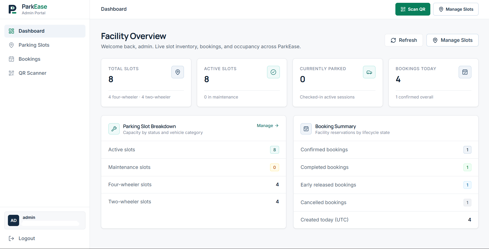
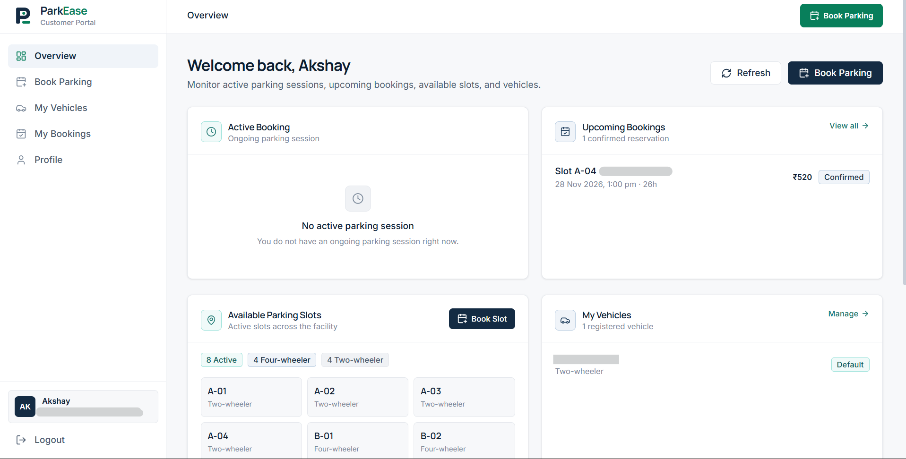
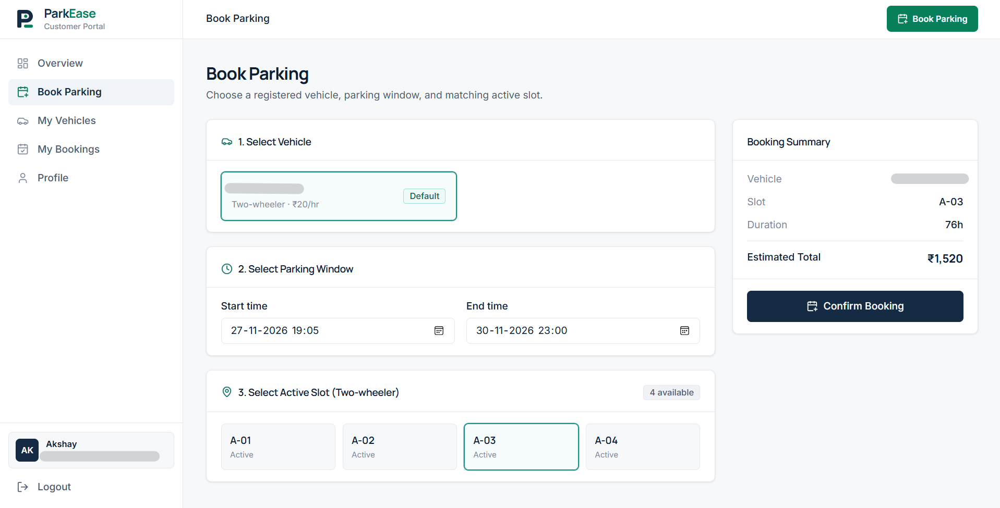
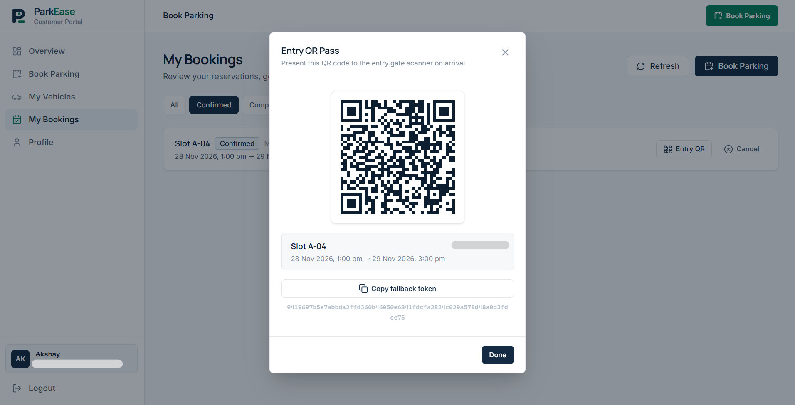

# ParkEase

ParkEase is a web-based parking facility management system for a single parking facility. It provides customers with a way to manage vehicles and reserve parking slots, while administrators manage slot inventory, reservations and QR-based gate operations.

## Screenshots

### Admin dashboard

Facility overview with slot inventory and booking statistics.



### Customer dashboard

A customer overview of active sessions, upcoming reservations, available slots and registered vehicles.



### Booking flow

Customers select a registered vehicle, choose a parking window and select an available slot.



### QR entry pass

A booking pass presented for verification at the facility entrance.



## Features

### Customer portal
- Register, sign in and verify an email address
- Recover and change account passwords
- Manage multiple registered vehicles and select a default vehicle
- View available parking slots
- Reserve a slot for a selected time window
- View booking history and reservation details
- Cancel eligible reservations
- Generate QR passes for gate access
- Retain a reservation after an early exit or release the unused reservation time

### Admin portal
- Role-protected administrator access
- View facility and booking statistics
- Create and manage individual parking slots
- Mark slots active or under maintenance
- View and filter customer reservations
- Inspect reservation and customer details
- Scan QR passes to record entry, exit and re-entry

### Reservation and gate operations
- Time-based reservations for individual parking slots
- Separate two-wheeler and four-wheeler slot categories
- Prevention of overlapping reservations
- Short-lived atomic slot locking during booking creation
- Fixed hourly pricing with duration rounded up to the next hour
- Recorded entry and exit timestamps
- Early exit with the choice to retain or release the remaining reservation
- Scheduled booking completion through a background job

## Technology stack

| Area | Technologies |
|---|---|
| Frontend | React, Vite, JavaScript |
| Backend | Node.js, Express.js |
| Database | MongoDB |
| ODM | Mongoose |
| Validation | Zod |
| Authentication | JWT, bcrypt |
| Email | Nodemailer |
| Scheduled jobs | node-cron |
| Testing | Vitest, Supertest, MongoDB Memory Server |

## Core application rules

| Rule | Behaviour |
|---|---|
| Facility scope | Single parking facility |
| Vehicle categories | Two-wheelers and four-wheelers |
| Two-wheeler rate | ₹20 per hour |
| Four-wheeler rate | ₹40 per hour |
| Billing duration | Rounded up to the next full hour |
| Active booking limit | One active booking per customer |
| Roles | Customer and admin |
| Online payments | Not included in the current MVP |

## Booking lifecycle

A reservation follows these states and gate events:

1. **Confirmed** — the reservation is created and the slot is reserved for its scheduled window.
2. **Checked In** — an administrator records the customer's entry by scanning the entry pass.
3. **Exited — Reservation Retained** — the customer exits early but keeps the remaining reservation time and can return.
4. **Re-entry** — an administrator scans the valid pass when the customer returns.
5. **Early Released** — the customer chooses to release the unused reservation time.
6. **Completed** — the scheduled reservation window ends and the background job processes completion.
7. **Cancelled** — an eligible reservation is cancelled.

An early exit alone does not release the reservation. The remaining slot time is retained unless the customer explicitly releases it.

## Architecture

The backend uses a modular, MVC-style structure. Request payloads are validated with Zod DTOs before controller and service logic is executed.

```text
backend/
├── src/
│   ├── config/
│   ├── middleware/
│   ├── module/
│   │   ├── auth/
│   │   ├── vehicles/
│   │   ├── parking-slots/
│   │   ├── booking/
│   │   └── admin/
│   ├── utils/
│   └── app.js
├── tests/
├── server.js
└── package.json

frontend/
├── src/
└── package.json
```

Request flow:

```text
Client
  → Express route
  → Authentication / authorization
  → Zod DTO validation
  → Controller
  → Service
  → Mongoose model
  → MongoDB
  → API response
```

## Getting started

### Prerequisites

- Node.js (LTS recommended)
- npm
- MongoDB (local instance or hosted database)
- Git

### 1. Clone the repository

```bash
git clone https://github.com/akshayg-dev/ParkEase.git
cd ParkEase
```

### 2. Set up the backend

```bash
cd backend
npm install
```

Create `backend/.env` using `backend/.env.example` as a template, then provide the required environment values.

Start the backend:

```bash
npm run dev
```

The current development configuration uses port `5050`.

### 3. Set up the frontend

Open a second terminal from the project root:

```bash
cd frontend
npm install
```

Create `frontend/.env` using `frontend/.env.example` and configure the backend API base URL.

Start the frontend:

```bash
npm run dev
```

Vite prints the local frontend URL in the terminal.

### 4. Run backend tests

From the backend directory:

```bash
npm test
```

The backend test suite uses Vitest, Supertest and MongoDB Memory Server.

Latest recorded local run: **56 tests passed across 6 test files**. Run the command above to verify the current checkout.

## Environment configuration

The application uses separate environment files:

- `backend/.env`
- `frontend/.env`

Use the corresponding `.env.example` files as templates. Never commit real environment files, database credentials, JWT secrets, email credentials or other private configuration.

## Deployment

Live application and API URLs can be added here after deployment.

## Potential future improvements

- Online payment integration
- Production monitoring and structured operational logs
- Additional analytics and reporting
- Expanded end-to-end test coverage

These are possible extensions beyond the current MVP scope.

## Repository structure

```text
ParkEase/
├── backend/
├── frontend/
├── docs/
│   └── screenshots/
├── .gitignore
└── README.md
```

---

**ParkEase — Smart parking facility management.**
